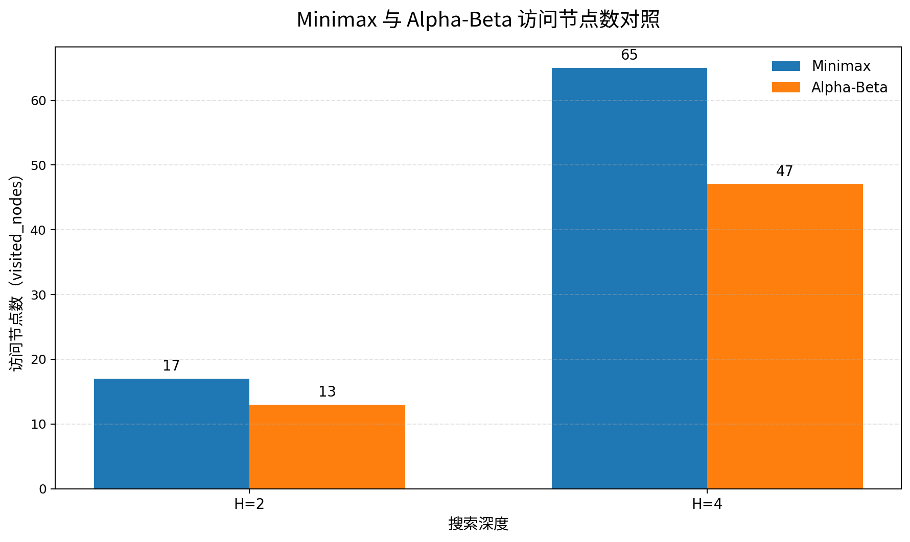

# 当代人工智能实验二：搜索算法

## 1. 算法设计与实验设置

### 1.1 实验目标

本次实验的目标是理解并实现 A* 搜索以及 Alpha-Beta 剪枝算法，并结合给定测试用例验证算法功能。具体包括：

1. 在含障碍物的二维网格中，利用 A* 搜索从起点到终点的最短路径；无路可达时返回空列表。
2. 在不同格子具有不同进入代价的地图中，计算从起点到终点的最小总代价。
3. 在给定博弈树上实现 Minimax 和 Alpha-Beta，计算 MAX 玩家能够保证的最佳得分。
4. 在宝藏分配场景中，先利用 A* 计算关键位置间的最小移动代价，再以 Minimax 和 Alpha-Beta 分析双方轮流选取宝藏时 A 的最优首步。
5. 通过更换启发函数、搜索算法及子节点访问顺序，比较搜索节点数量和剪枝情况，并分析原因。

### 1.2 实验环境

| 项目 | 配置 |
|---|---|
| 操作系统 | Windows，使用 PowerShell 终端运行 |
| 编程语言 | Python 3.12.5 |
| 依赖 | Python 标准库，无需安装第三方包 |
| 运行命令 | `python -u experiment2.py` |
| 主要数据结构 | 二维列表、元组坐标、字典、优先队列、树节点、不可变博弈状态 |

程序通过 Python 标准库中的heapq实现优先队列，通过dataclass表示树节点和博弈状态。实验数据以程序实际运行输出为准。

### 1.3 A* 搜索的基本设计

A* 对每个待搜索状态计算评价函数：f(n)=g(n)+h(n)
其中，g(n)表示从起点到当前节点的实际累计代价，h(n)表示从当前节点到目标节点的启发式估计代价，f(n)是经过当前节点到达目标的估计总代价。程序使用最小堆保存待扩展节点，每次取出优先级最低的节点。

搜索过程中使用best_g记录当前已知的最小到达代价，并使用parent记录节点的前驱。发现更小的g值时更新记录并重新入队；到达目标后，从目标沿parent回溯并反转，即可恢复起点到终点的路径。若优先队列耗尽仍未到达目标，则返回无解结果。

普通网格的曼哈顿启发函数为：h(n)=|r_n-r_E|+|c_n-c_E|
在只允许上下左右移动、每步代价均为1的条件下，曼哈顿距离不会高估剩余步数，是可采纳的启发函数。将h(n)设为0时，A* 退化为 Dijkstra 式搜索，可作为对照基线。

### 1.4 Minimax 与 Alpha-Beta 的基本设计

Minimax假设双方都采取对自己最有利的策略。MAX节点选择子节点中的最大值，MIN节点选择子节点中的最小值：

\[
V(n)=\begin{cases}
\max\limits_{c\in Children(n)}V(c), & n\text{ 为 MAX 节点}\\
\min\limits_{c\in Children(n)}V(c), & n\text{ 为 MIN 节点}
\end{cases}
\]

递归从叶节点返回评价值，逐层回传至根节点。Alpha-Beta 在 Minimax 的基础上维护两个边界：α表示MAX当前已经能够保证的下界，β表示MIN当前已经能够保证的上界。当：α≥β，说明当前分支不可能改变祖先节点已经能够确定的选择，因此可以停止访问当前节点剩余的子节点。剪枝只减少搜索工作，不改变 Minimax 的正确决策值。

### 1.5 性能统计口径
为便于比较，本实验使用程序输出的统计量：
- **expanded_nodes（展开节点数）：** A* 中从优先队列取出有效节点、确认不是目标并继续检查邻居的节点数。到达目标后立即返回，因此目标节点不计入展开数。
- **visited_nodes（访问节点数）：** Minimax/Alpha-Beta 递归实际进入的节点数。题目四的统计包含根状态。
- **leaf_evaluations（叶节点计算数）：** 搜索到叶节点或指定深度边界时实际计算评价值的次数。
- **cutoffs（剪枝发生次数）：** 满足α≥β并终止当前节点剩余子节点搜索的次数。
- **pruned_children（被跳过的直接子节点数）：** 因剪枝而没有继续访问的当前层直接子节点数，不代表这些子节点后代的总数量。

---

## 2. 题目一：迷宫寻路

### 2.1 问题建模

题目一给出二维网格，S为起点，E为终点，.为可通行格，X为障碍物。起点坐标为(0,0)，终点坐标为(3,4)。每次只能向上、下、左、右移动一格，每移动一格的代价都是1。程序需要返回从起点到终点的坐标序列；如果不存在可行路径，则返回空列表。

### 2.2 算法实现

将每个可通行坐标视为一个搜索节点。程序从起点开始，将起点的g值设为0，并将其放入优先队列。每次取出 f=g+h 最小的节点，检查其四个相邻位置：若位置越界或为障碍物则跳过；否则计算新的累计代价 new_g=g+1。当 new_g 小于该邻居当前记录的代价时，更新其代价和父节点，并将其加入优先队列。

本题分别使用两种启发函数进行对照：

- h=0：不提供到目标的距离信息，作为 Dijkstra 式基线。
- 曼哈顿距离：利用当前坐标与终点坐标的行列差估计剩余步数。

### 2.3 实验结果

曼哈顿距离得到的路径为：

```text
(0,0) → (0,1) → (0,2) → (1,2)
      → (1,3) → (1,4) → (2,4) → (3,4)
```

该路径共包含8个坐标点，即移动7步，与讲义给出的预期路径一致。两种启发函数的展开节点数如下：

| 启发函数 | 展开节点数 | 路径是否达到最短 |
|---|---:|---|
| h=0 | 15 | 是 |
| 曼哈顿距离 | 7 | 是 |

展开节点数从15减少到7，减少比例约为53.33%。

### 2.4 结果分析

两种方法都找到了最短路径，说明在单位步长、四方向移动的条件下，曼哈顿距离没有破坏 A* 的最优性。与 h=0 相比，曼哈顿距离为每个节点提供了朝向终点的估计信息，使搜索优先考虑更接近目标的节点，因而减少了不必要的节点展开。

启发函数并不会改变问题本身的最短路径长度，而是影响搜索过程中节点被取出和扩展的顺序。实验中节点数减少约53.33%，说明该地图上曼哈顿距离具有较好的引导作用。

---

## 3. 题目二：加权地形

### 3.1 问题建模

题目二把普通网格扩展为加权地形。数字表示进入该格子的移动代价，例如1表示代价为1，3表示代价为3，8表示代价为8。移动仍然只能上下左右进行。由节点A移动到相邻节点B的代价等于进入B所在格子的权值；起点格不计入代价，进入终点E的代价按题目规定为0。

因此，路径总代价不是移动步数，而是每一步进入目标格子的代价之和：

\[
g(path)=\sum_{i=1}^{k} cost(v_i)
\]

其中起点 \(v_0\) 不计费，终点E的进入代价为0。

### 3.2 算法实现与启发函数

加权 A* 与题目一使用相同的优先队列和父节点恢复机制，区别在于邻居代价变为：

\[
g_{new}=g(current)+cost(neighbor)
\]

不能再固定加1。程序在本题中比较修正曼哈顿启发函数与h=0:
- h=0：等价于 Dijkstra 式搜索。
- 修正曼哈顿距离：考虑终点E免费进入这一规则。设当前节点到终点的曼哈顿距离为 \(d_1\)，普通可进入格子的最小正进入代价为 \(w_{min}\)，终点进入代价为 \(c(E)\)，则对非终点节点使用下界：

\[
h(n)=(d_1(n,E)-1)w_{min}+c(E),\quad d_1(n,E)\geq1
\]

到达终点时令 \(h(E)=0\)。本题中 \(w_{min}=1\)、\(c(E)=0\)，所以启发函数相当于把最后进入E的一步从普通曼哈顿步数中扣除。普通曼哈顿距离直接按每一步至少支付一个单位估算，会把免费进入E的最后一步也计入，所以在本题规则下可能高估剩余代价，不宜直接作为保证最优性的启发函数。

### 3.3 实验结果

程序得到的最优路径为：

```text
(0,0) → (1,0) → (2,0) → (3,0) → (3,1)
      → (3,2) → (4,2) → (4,3) → (4,4)
```

路径进入各格子的代价累计如下：

| 移动 | 进入格子的代价 | 累计代价 |
|---|---:|---:|
| `(0,0) → (1,0)` | 1 | 1 |
| `(1,0) → (2,0)` | 1 | 2 |
| `(2,0) → (3,0)` | 1 | 3 |
| `(3,0) → (3,1)` | 1 | 4 |
| `(3,1) → (3,2)` | 1 | 5 |
| `(3,2) → (4,2)` | 1 | 6 |
| `(4,2) → (4,3)` | 1 | 7 |
| `(4,3) → E` | 0 | 7 |

两种搜索方式的结果如下：

| 方法 | 最小总代价 | 展开节点数 |
|---|---:|---:|
| 修正曼哈顿 A* | 7 | 10 |
| h=0（Dijkstra 式搜索） | 7 | 14 |

展开节点数减少比例约为28.57%

### 3.4 结果分析

两种方法均得到最小总代价7，说明修正启发函数在当前地图上没有改变最优解。与h=0相比，修正曼哈顿启发函数将展开节点数从14降为10，减少约28.57%。

最重要的是要区分“路径步数”和“路径代价”。一条经过较多格子的路径，仍有可能因为经过的地形代价较低而具有更小的总代价。算法因此必须根据进入邻居格子的权值更新g，不能把所有移动都视为代价1。

同时，终点免费进入会影响启发函数的可采纳性。若直接使用普通曼哈顿距离，紧邻E的节点到终点的真实剩余代价为0，但普通曼哈顿距离为1，出现高估。修正后的启发函数扣除了最后一步的普通进入代价，使其成为当前规则下的代价下界。该处理说明设计启发函数时必须与实际代价定义保持一致。

---

## 4. 题目三：Alpha-Beta 剪枝

### 4.1 问题建模

题目三给出一棵极大极小博弈树，根节点为MAX玩家，下一层为MIN玩家，之后交替。叶节点保存评价值。MAX希望最大化最终得分，MIN希望最小化最终得分。程序按从左到右的顺序访问子节点，并返回根节点对MAX而言的最佳结果。

### 4.2 Minimax 数值回传

按照树结构从叶子向根节点计算：
- 左侧MIN节点的两个MAX子节点分别返回5和9，因此左侧MIN返回 min(5,9)=5。
- 右侧MIN节点的两个MAX子节点分别返回9和2，因此右侧MIN返回 min(9,2)=2`。
- 根节点为MAX，返回 max(5,2)=5`。

所以根节点的Minimax值为5，与预期结果一致。

### 4.3 Alpha-Beta 剪枝依据

Alpha-Beta在深度优先递归中维护α和β。MAX节点更新当前最好值和α，MIN节点更新当前最好值和β。一旦满足α≥β，当前节点剩余子节点就不可能影响祖先节点的选择，可以剪枝。

主实验按照讲义要求从左到右访问节点，另外设置一个仅反转右侧MIN节点子节点顺序的对照实验，用于分析访问顺序对剪枝的影响；该反转实验仅用于性能比较，不替代正式的左到右实现。

### 4.4 实验结果

| 方法 | 根节点结果 | 访问节点数 | 叶节点计算数 | 剪枝次数 | 跳过的直接子节点数 |
|---|---:|---:|---:|---:|---:|
| Minimax | 5 | 15 | 8 | 0 | 0 |
| Alpha-Beta（原顺序） | 5 | 14 | 7 | 1 | 1 |
| Alpha-Beta（反转右侧 MIN 子节点） | 5 | 11 | 5 | 2 | 2 |

原顺序下，Alpha-Beta 相比 Minimax 将访问节点数从15降至14，叶节点计算数从8降至7，最终结果始终为5。反转右侧MIN节点的子节点顺序后，访问节点数进一步降至11，叶节点计算数降至5，最终结果仍为5。

### 4.5 结果分析

Minimax必须递归计算每个子树的结果；Alpha-Beta则利用已经得到的上下界排除不可能影响最终决策的分支。因此，Alpha-Beta 与 Minimax 的根节点结果应保持一致，差别主要体现在搜索开销上。

实验还表明，Alpha-Beta 的剪枝效果与节点访问顺序有关。如果较早访问到对当前玩家有利的子节点，α或β可能更快收紧，从而使后续分支更容易满足剪枝条件。本实验仅反转右侧MIN节点的孩子顺序，访问节点数由14降至11，说明在同一棵树上，仅改变访问顺序也可能明显影响搜索量。但是节点数下降不意味着 Minimax 结果发生变化；合理剪枝应该在保持结果不变的前提下减少搜索。

---

## 5. 题目四：竞争环境下的宝藏分配

### 5.1 问题建模与规则

综合题包含两个玩家A（MAX）和 B（MIN），以及四个宝藏。地图中的X为障碍物，数字表示进入该格子的代价；A、B 和宝藏所在格子的进入代价为 1。玩家只能上下左右移动。行动顺序为 A、B、A、B，每回合选择一个尚未被领取的宝藏。经过其他宝藏不会自动收集；被领取的宝藏位置仍然可以通行；另一名玩家不阻挡寻路。

宝藏位置和价值如下：

| 宝藏 | 坐标 | 价值 |
|---|---|---:|
| T1 | (0,6) | 9 |
| T2 | (2,2) | 6 |
| T3 | (4,4) | 7 |
| T4 | (6,0) | 7 |

### 5.2 使用 A* 构建距离矩阵

首先把A、B、T1、T2、T3、T4作为六个关键位置。对每一对关键位置调用加权A*，计算从起点位置到目标位置的最小移动代价，最终形成6×6距离矩阵。因为这些关键位置的进入代价均为1，且地图移动规则不区分方向，计算出的矩阵呈对称结构，对角线为0。

节点顺序为：A、B、T1、T2、T3、T4。实验得到的距离矩阵为：

| 起点/终点 | A | B | T1 | T2 | T3 | T4 |
|---|---:|---:|---:|---:|---:|---:|
| A | 0 | 12 | 10 | 4 | 8 | 8 |
| B | 12 | 0 | 8 | 8 | 4 | 10 |
| T1 | 10 | 8 | 0 | 6 | 6 | 12 |
| T2 | 4 | 8 | 6 | 0 | 6 | 6 |
| T3 | 8 | 4 | 6 | 6 | 0 | 6 |
| T4 | 8 | 10 | 12 | 6 | 6 | 0 |

该矩阵将地图寻路问题转换为关键位置之间的代价查询。后续博弈不再重复在原地图上搜索路径，而是直接从矩阵读取当前位置到目标宝藏的最小代价。

### 5.3 博弈状态与状态转移

程序使用GameState表示一个博弈状态，至少包含：

| 字段 | 含义 |
|---|---|
| pos_a | 玩家A当前所在位置 |
| pos_b | 玩家B当前所在位置 |
| remaining | 尚未被领取的宝藏集合 |
| score_a | A的累计收益 |
| score_b | B的累计收益 |
| player | 当前行动玩家，取A或B |

初始状态为：A位于A起点、B位于B起点，剩余宝藏为T1～T4，双方累计收益均为0，当前行动者为A。

当玩家选择一个宝藏时，程序执行以下状态更新：

1. 从 `remaining` 中删除被选择的宝藏。
2. 将当前行动玩家的位置更新为该宝藏位置。
3. 读取当前玩家位置到宝藏的最小移动代价。
4. 按收益公式更新对应玩家的累计收益。
5. 将行动玩家切换为另一方。

收益函数为：

\[
Gain(p,T_i)=V_i-d(p,T_i)
\]

整体效用函数为：

\[
U=Score_A-Score_B
\]

A选择使U最大的行动，B选择使U最小的行动。当搜索深度达到指定值或宝藏已经取完时，使用当前U作为叶节点评价值。

### 5.4 H=2 与 H=4 的决策结果

H表示从根状态开始考虑的选择回合数。H=2表示A、B各行动一次；H=4表示A、B、A、B依次行动。实验分别运行 Minimax 和 Alpha-Beta，结果如下：

| 搜索深度 | 算法 | 最优首步 | 最优收益差 |
|---|---|---|---:|
| H=2 | Minimax | T2 | -1 |
| H=2 | Alpha-Beta | T2 | -1 |
| H=4 | Minimax | T3 | 3 |
| H=4 | Alpha-Beta | T3 | 3 |

两种算法在相同深度下得到完全一致的最优首步和收益差，符合 Alpha-Beta 只优化搜索过程、不改变 Minimax 决策结果的性质。

### 5.5 H=2 与 H=4 决策差异分析

搜索深度增加后，A的最优首步由T2变为T3。这说明决策结果受到后续回合影响，不能只根据当前一步的宝藏价值或当前移动代价进行判断。

在H=2时，A先选择T2，从A到T2的代价为4，获得收益6-4=2。随后B从初始位置B选择T3，从B到T3的代价为4，获得收益7-4=3。因此：

\[
U=2-3=-1
\]

在H=4的一条最优行动序列中：A先选择T3，B选择T1，A选择T2，B最后选择T4。对应收益为：

| 回合 | 玩家 | 选择 | 移动代价 | 本回合收益 |
|---|---|---|---:|---:|
| 1 | A | T3 | 8 | 7-8=-1 |
| 2 | B | T1 | 8 | 9-8=1 |
| 3 | A | T2 | 6 | 6-6=0 |
| 4 | B | T4 | 12 | 7-12=-5 |

最终：

\[
Score_A=-1+0=-1
\]

\[
Score_B=1-5=-4
\]

\[
U=Score_A-Score_B=-1-(-4)=3
\]

因此，H=4时选择T3能在考虑双方后续位置和剩余宝藏分配的情况下取得更高的最终收益差。与H=2相比，H=4考虑的信息更多，能够反映当前选择对后续移动代价和可选宝藏集合的影响。这也说明在竞争环境中，局部看起来收益较高的选择不一定是更深层博弈中的最优首步。

### 5.6 Minimax 与 Alpha-Beta 的性能对照

| 深度 | 算法 | 访问节点数 | 叶节点计算数 | 剪枝次数 | 跳过的直接子节点数 | 最优收益差 |
|---|---|---:|---:|---:|---:|---:|
| H=2 | Minimax | 17 | 12 | 0 | 0 | -1 |
| H=2 | Alpha-Beta | 13 | 8 | 2 | 4 | -1 |
| H=4 | Minimax | 65 | 24 | 0 | 0 | 3 |
| H=4 | Alpha-Beta | 47 | 16 | 5 | 6 | 3 |


H=2时，Alpha-Beta的访问节点数比Minimax少4个，减少约23.53%；叶节点计算数少4 个，减少约33.33%。H=4时，访问节点数少18个，减少约27.69%；叶节点计算数少8个，减少约33.33%。两种算法的最优首步和最优收益差均保持不变。

随着搜索深度增大，博弈树分支数增加，Minimax 需要计算更多状态。Alpha-Beta 通过上下界剪枝减少部分分支的访问，因此能在不改变决策结果的前提下减少搜索工作。H=4的节点数差异比H=2更明显，说明在较深搜索中剪枝具有更大的潜在价值。

### 5.7 不同宝藏访问顺序对剪枝的影响

为了进一步研究搜索顺序，本实验在 H=4 下比较 natural、reverse 和 heuristic 三种顺序。三种顺序均使用相同地图、距离矩阵、宝藏价值和搜索深度，仅调整当前节点枚举剩余宝藏的先后次序。

| 访问顺序 | 最优首步 | 最优收益差 | 访问节点数 | 叶节点计算数 | 剪枝次数 | 跳过的直接子节点数 |
|---|---|---:|---:|---:|---:|---:|
| natural | T3 | 3 | 47 | 16 | 5 | 6 |
| reverse | T3 | 3 | 46 | 16 | 4 | 5 |
| heuristic | T3 | 3 | 50 | 18 | 2 | 3 |

三种顺序得到的最优首步和最优收益差完全相同，但搜索开销存在差异。reverse的访问节点数为46，比natural的47少1个；heuristic的访问节点数为50，比natural多3个，叶节点计算数也从16增加到18。

这一结果说明，使用即时收益进行排序并不必然提高 Alpha-Beta 的剪枝效率。即时收益只反映当前一步的宝藏价值 - 移动代价，而真正决定博弈结果的是后续多个回合的状态变化和双方最优响应。局部收益排序与整棵子树的 Minimax 值并不总是一致，所以heuristic顺序在本次地图上没有带来更好的剪枝效果。搜索顺序优化需要尽量让更可能影响最终决策的子树先被访问，而不能仅凭单步收益判断。

---

## 6. 自设对照实验与拓展

### 6.1 拓展一：启发函数对搜索规模的影响

题目一比较h=0与曼哈顿距离，题目二比较h=0与考虑免费终点规则的修正曼哈顿距离。结果分别为：

| 题目 | 基线展开节点数 | 启发式展开节点数 | 节点数变化 |
|---|---|---|---|
| 题目一 | 15 | 7 | 减少53.33% |
| 题目二 | 14 | 10 | 减少28.57% |

两个实验均保持最优路径或最小代价不变，说明在启发函数满足可采纳性等适用条件时，可以利用目标距离信息减少搜索工作。但题目二的启发函数必须根据进入终点的真实代价进行修正，不能机械照搬普通曼哈顿距离。

### 6.2 拓展二：节点访问顺序对 Alpha-Beta 的影响

题目三在保持树结构和叶子分数不变的情况下，仅反转右侧MIN节点的子节点顺序；题目四在保持地图、宝藏价值和深度不变的情况下，比较三种宝藏访问顺序。实验结果显示：

- 题目三 Alpha-Beta 原顺序访问14个节点，反转指定节点后访问11个节点，根节点值均为5。
- 题目四H=4下 natural、reverse、heuristic 分别访问47、46、50个节点，最终结果均为T3、3。

这两个实验共同说明：Alpha-Beta 的正确性不依赖某一种固定的访问顺序，但剪枝效率会受到顺序影响。良好的排序能够让边界更早收紧；不合适的排序可能使搜索节点增加。

### 6.3 拓展三：搜索深度对决策和开销的影响

题目四比较 H=2 和 H=4：

| 深度 | 最优首步 | 收益差 | Minimax 访问节点数 | Alpha-Beta 访问节点数 |
|---|---|---|---|---|
| H=2 | T2 | -1 | 17 | 13 |
| H=4 | T3 | 3 | 65 | 47 |

深度从2增加到4后，A的最优首步由T2变为T3，最优收益差由-1变为3。这表明搜索深度不仅影响计算量，也可能改变策略判断。更深搜索能够考虑更多后续行动，但节点数量随分支展开而增长，因此需要在决策质量与计算开销之间权衡。

### 6.4 拓展四：自设小型迷宫与特殊情况测试

为检验题目一的 A* 实现是否只适用于讲义给定地图，本实验额外设计了一张 5×5 小型迷宫。起点为 `(0,0)`，终点为 `(4,4)`，地图如下：

```text
S . . X .
X X . X .
. . . . .
. X X X .
. . . . E
```

分别使用曼哈顿距离和h=0运行 A*，得到的最短路径都是8步。搜索统计：
| 启发函数 | 最短步数 | 展开节点数 |
|---|---|---|
| 曼哈顿距离 | 8 | 8 |
| h=0 | 8 | 12 |

在该自设地图上，曼哈顿距离将展开节点数从12减少到8，减少比例为33.33%。两种方法得到相同的最短步数，说明启发函数减少了搜索范围，但没有改变最优路径长度。

此外，还测试了两种特殊情况：
| 特殊情况 | 输入特点 | 实际输出 | 结果判断 |
|---|---|---|---|
| 无解迷宫 | 起点的上下左右均被边界或障碍物阻断 | `[]` | 符合要求 |
| 起点等于终点 | 地图仅含一个格子，起点和终点均为 `(0,0)` | `[(0,0)]`，展开节点数为 0 | 符合预期 |

这两项测试分别检查了搜索失败时的返回行为，以及无需移动即可到达目标时的边界处理。更新后的程序会自动执行这三组自设测试，并通过断言检查最短步数、无解返回值和起点等于终点的结果。全部通过后输出[PASS]。

### 6.5 拓展结论

本实验除使用讲义给定样例进行正式验证外，还通过改变启发函数、调整搜索顺序、改变博弈搜索深度，以及增加自设迷宫和特殊边界情况来观察算法行为。实验结果表明：启发函数能够影响 A* 的搜索范围；Alpha-Beta 的剪枝效率依赖访问顺序；博弈搜索深度可能改变最优策略；对无解和起点等于终点等特殊情况进行测试，则有助于验证算法实现的健壮性。

---

## 7. 图表展示与独立思考

### 7.1 搜索规模对照汇总

| 实验 | 对照方式 | 基线节点数 | 改进/对照节点数 | 结果是否一致 |
|---|---|---:|---:|---|
| 题目一 | `h=0` → 曼哈顿 | 15 | 7 | 最短路径一致 |
| 题目二 | `h=0` → 修正曼哈顿 | 14 | 10 | 最小代价均为 7 |
| 题目三 | Minimax → Alpha-Beta | 15 | 14 | 得分均为 5 |
| 题目三 | Alpha-Beta 原顺序 → 指定反转顺序 | 14 | 11 | 得分均为 5 |
| 题目四 H=2 | Minimax → Alpha-Beta | 17 | 13 | T2、-1 一致 |
| 题目四 H=4 | Minimax → Alpha-Beta | 65 | 47 | T3、3 一致 |

### 7.2 主要实验结论

1. **启发函数的作用是减少搜索，而不是改变最优解。** 题目一的曼哈顿距离和题目二的修正曼哈顿距离均在保持最优结果的情况下减少展开节点数。启发函数必须满足问题代价规则，否则可能高估真实剩余代价并影响最优性保证。
2. **加权搜索必须累计进入目标格子的实际代价。** 题目二若仍按每步加 1 计算，就会把不同地形视为相同代价，无法正确解决加权最短路径问题。终点E的免费进入规则也必须在代价函数和启发函数中保持一致。
3. **Alpha-Beta 与 Minimax 的决策值相同，但搜索量可能不同。** 剪枝根据已经获得的上下界排除不可能影响最终决策的分支，不改变 Minimax 的理论结果。
4. **访问顺序会影响剪枝效率。** 题目三的指定反转顺序减少了访问节点；题目四的 heuristic 顺序反而增加了节点数，说明简单的即时收益排序不一定等同于最有效的 Minimax 子树排序。
5. **搜索深度会影响策略结果。** 题目四从 H=2 增加到 H=4 后最优首步由 T2 变成 T3，说明多回合博弈需要考虑双方后续位置、收益和剩余宝藏，而不能只看当前一步。

### 7.3 实现中的改进方向
后续可以从以下方面改进：

- 将题目四地图、关键点位置、宝藏价值和初始玩家位置封装为参数，避免依赖全局常量。
- 在宝藏较多时加入状态缓存（例如对当前位置、剩余宝藏集合、当前玩家进行记忆化），减少重复子问题计算。
- 进一步研究更有效的子节点排序策略，并使用相同输入对比节点数，而不是仅凭排序规则名称判断优劣。
- 增加更多边界输入测试，例如无解迷宫、起点等于终点、不同地形权值组合和宝藏数量变化，以检验程序的健壮性。

---

## 8. 总结

实验完成了四项搜索算法任务。题目一通过 A* 在普通迷宫中找到最短路径，并验证曼哈顿距离相比h=0减少了展开节点数；题目二实现按进入格子权值累计代价的加权 A*，并针对终点免费进入的规则设计修正启发函数，得到最小总代价 7；题目三实现 Minimax 和 Alpha-Beta，均得到根节点最佳值 5，并通过改变节点访问顺序观察剪枝开销变化；题目四利用 A* 计算六个关键位置之间的距离矩阵，设计记录双方位置、剩余宝藏、累计收益和当前玩家的博弈状态，得到 H=2 时 T2、-1，H=4 时 T3、3 的结果。

从实验数据可以看出，A* 的启发函数和 Alpha-Beta 的剪枝都旨在减少搜索工作，但二者依赖的条件不同：A* 需要启发函数符合代价下界要求，才能保证最优性；Alpha-Beta 则依赖当前搜索中形成的上下界，访问顺序影响剪枝效率但不应改变最终 Minimax 值。综合题进一步说明，在多回合竞争环境下，局部收益并不能完全代表整体策略价值，搜索深度和双方后续响应都会影响最优首步。

通过本次实验，我不仅完成了算法编码，也进一步理解了搜索算法的性能不能只通过运行时间判断，还需要结合展开节点数、访问节点数、叶节点计算数和剪枝次数分析。同时，实验结果必须与明确的代价定义、状态转移规则和统计口径对应，才能保证比较公平、结论可信。